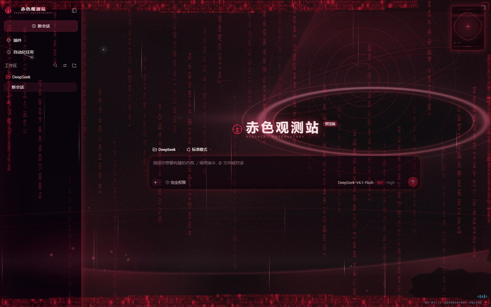
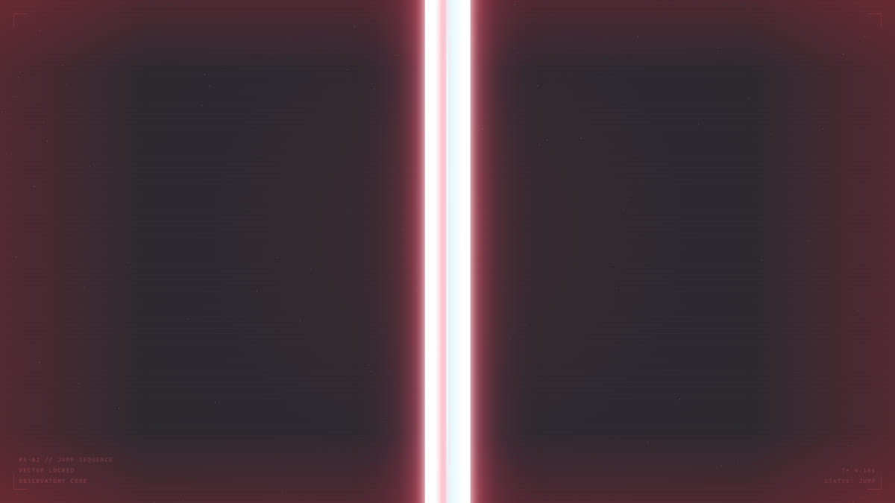

# 赤色观测站 · Redshift Observatory

一套给 **DeepSeek Harness** Web 主界面的深空赤色主题：暗红基底、引力透镜场景、虚空撕裂光带、
观测站 HUD 与一枚常驻的观测窗。

> 第三方插件，非 DSH 官方作品。基于 DSH 0.2.x 的 `cordis` 插件体系开发。



---

## 它做了什么

### 1. 配色：114 个 token 全量重映射

不是只改几处颜色，而是把 `ctx.theme` 暴露的 **114 个 `--dsw-*` token** 全部重映射成一套赤色体系
（`DARK` / `LIGHT` 两套值），整层可撤销。

- 用 `Theme.listTokens` 返回的**真实 token 名**，写不存在的名字不会报错、但也永远不生效
- `bg-base` 设成半透明，让背景场景透出来
- **不改用户的主题偏好**：`overrideTokens` 是叠层，不是注册新主题再 `setTheme` 抢占

### 2. 背景：程序化生成的深空

`assets/scene.jpg`（2560×1440）**由脚本从零绘制**，不贴任何外部图片：

```
底色径向渐变 → 星云层（三次不同模糊半径）→ 斜向尘埃带
→ 引力透镜黑洞（主环 + 次级像 + 吸积盘光带 + 事件视界）
→ 弧形地平线（亮边 + 地表颗粒 + 天际线细塔剪影）
→ 前景小行星剪影 → 两层星点（细星 + 带十字芒的亮星）
→ 暗角 + 颗粒 + 极轻色散
```

生成脚本见仓库 `tools/make-scene.py`（依赖 numpy + Pillow，无网络、无素材）。
图片走 Host 侧只读路由 `/redshift/scene.jpg` 下发，不塞进客户端脚本。

### 3. 撕裂层：光带 + 引力波 + 星尘

在 `shell.overlay` 槽位里挂一层 React 组件（卸载时自动摘干净，不往 `document.body` 塞节点）：

| 元素 | 实现 |
|---|---|
| 虚空撕裂光带 | 4 条，互质周期，避免同步 |
| 引力波 | 29 秒一轮的下扫光带 |
| 星尘 | 46 颗 |
| 网格 | 52px / 13px 双密度 |
| 噪点 | SVG `feTurbulence` |
| HUD | 四角角标 + 底部刻度 + 6 条数据流 |
| 常驻字符流 | 32 列竖排，周期 26–56 秒随机 |
| 过载 | 每 7–14 秒一次（错切 + 红白条纹 + 色差 + 乱码 + 冲击波） |
| 观测窗 | 右上角 112×150，双环 + 刻度环 + 扫描线 + 呼吸点（纯 CSS，无图片） |
| 状态灯 | 右下角呼吸点，用来看插件是否在跑 |



### 4. 品牌改造

侧栏徽记与名称、hero 区标题都重映射成「观测中枢 / OBSERVATORY CORE」。

---

## 安装

### 方式一：本地 link（开发时最方便）

```bash
git clone https://github.com/ywxtxws/dsh-theme-redshift.git
cd dsh-theme-redshift
dsh plugin --profile web add link:/绝对路径/dsh-theme-redshift
```

### 方式二：打包安装

```bash
npm pack
dsh plugin --profile web add ./dsh-theme-redshift-0.3.0.tgz
```

### 方式三：手动放进 profile

1. 把整个目录复制到 `~/.dsh/profiles/web/node_modules/dsh-theme-redshift/`
2. 在该 profile 的 `package.json` 里加上：

```json
{
  "dependencies": { "dsh-theme-redshift": "link:/绝对路径/dsh-theme-redshift" },
  "dsh": { "profile": { "bundles": [ "...", "dsh-theme-redshift" ] } }
}
```

3. **重启 DSH**，刷新页面。

> ⚠️ 插件的 `client.js` 会被打进 client bundle 并**缓存在 Host 内存**里，
> 改完必须重启 DSH 才生效，光刷新页面不够。

## 配置

配色、光带周期、HUD 文案都可以直接改 `lib/client.js` 顶部的常量。

## 兼容性

- 需要 **DSH 0.2.x**（`engines.node >= 20`）
- 只做 `client` 半侧 + 一个只读静态路由，不注入任何 Service，冲突面很小
- 会覆盖 DSH 的 **114 个主题 token**——如果同时装了别的主题插件，后加载的赢

## 文件结构

```
lib/index.js       Host：/redshift/scene.jpg 只读路由
lib/client.js      浏览器：配色 + 背景 + 撕裂层 + HUD + 观测窗
assets/scene.jpg   背景场景（2560×1440，程序化生成）
locale/zh.json     「赤色观测站」
locale/en.json     "Redshift Observatory"
icon.svg           观测站图标（手写 SVG）
cordis.patch.yml   bundle 补丁
tools/make-scene.py 背景生成脚本
```

## 素材

**全部内容都由代码生成，不含任何第三方图片、字体或音频。**

- 背景图：`tools/make-scene.py` 用 numpy + Pillow 从零绘制
- 图标与徽记：手写 SVG
- 撕裂光带、网格、星尘、扫描线、噪点：纯 CSS + SVG `feTurbulence`
- 观测窗：纯 CSS（`conic-gradient` + `mask` + 关键帧）

字体一律使用系统默认的等宽/无衬线字体，不内嵌字体文件。

## 已知限制

- 背景图带 `no-cache`，改图后刷新即可看到；但 `client.js` 的改动仍需重启
- 观测窗固定右上角（`right: 22px; top: 20px`），窄屏下可能与其他悬浮元素重叠

## 许可

[MIT](LICENSE)